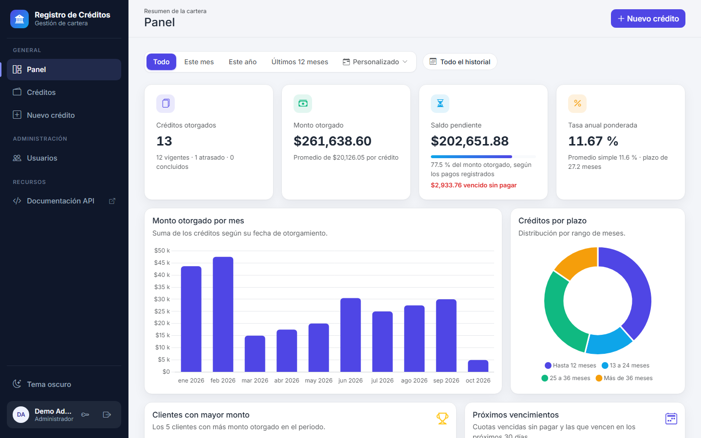
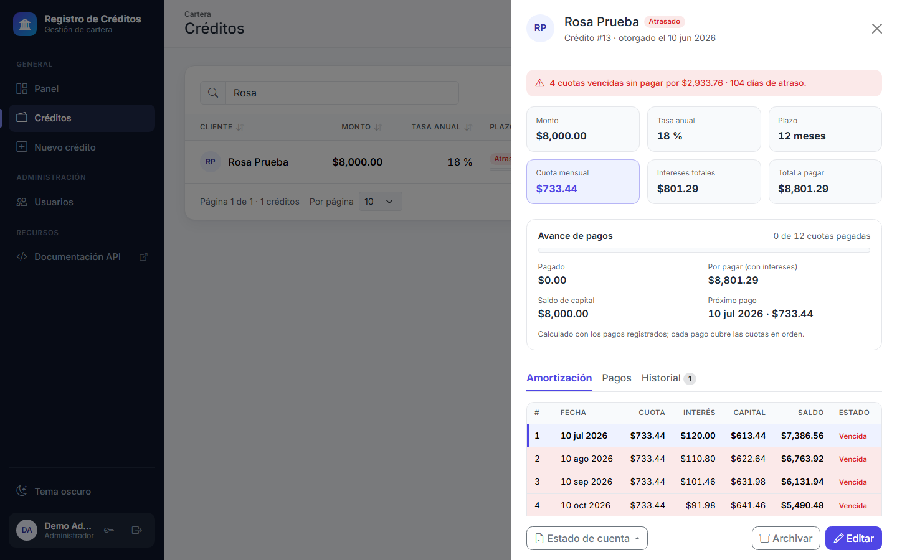
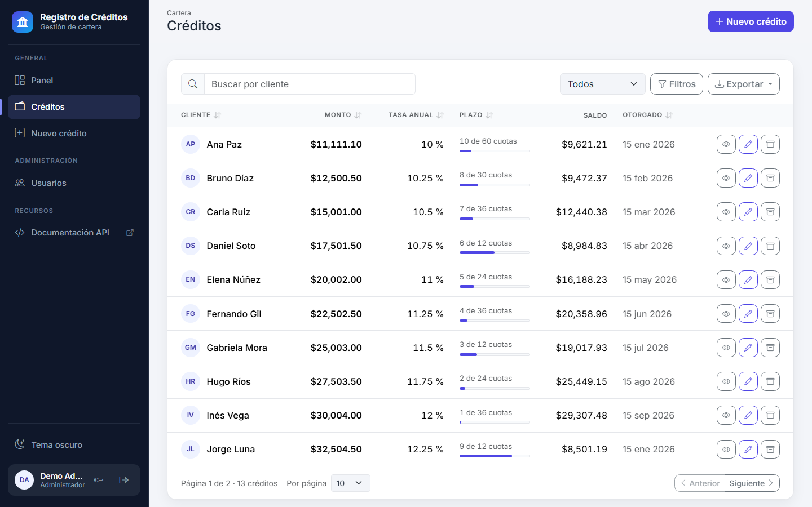
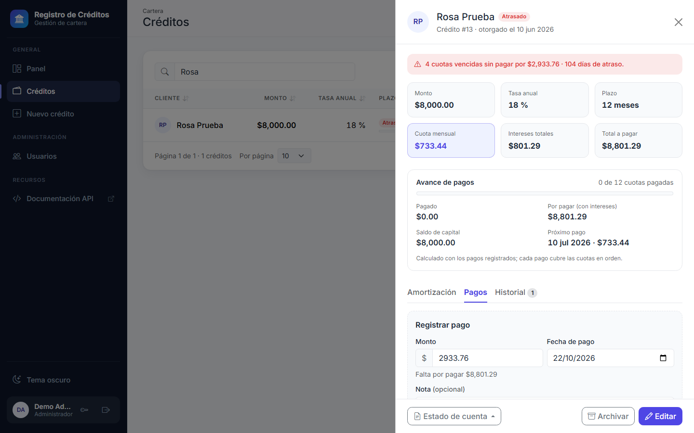
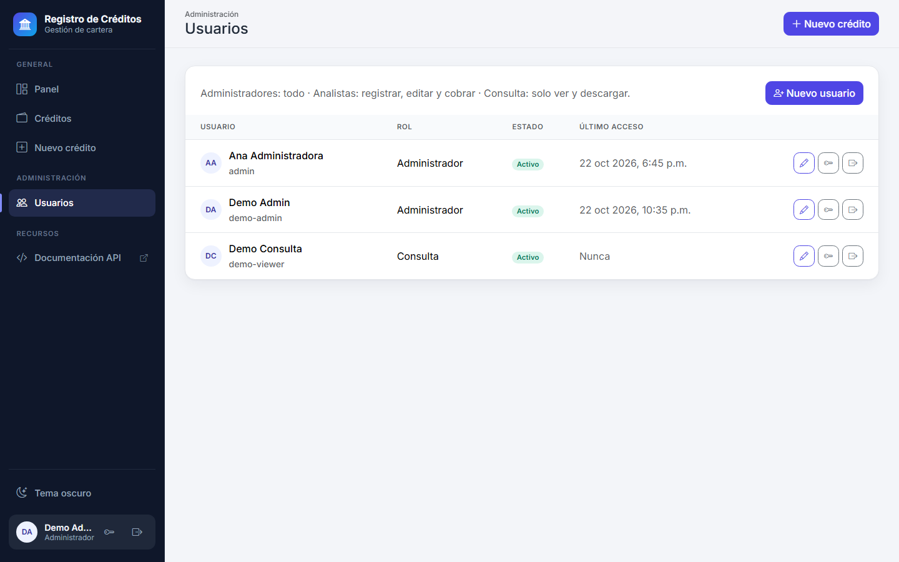
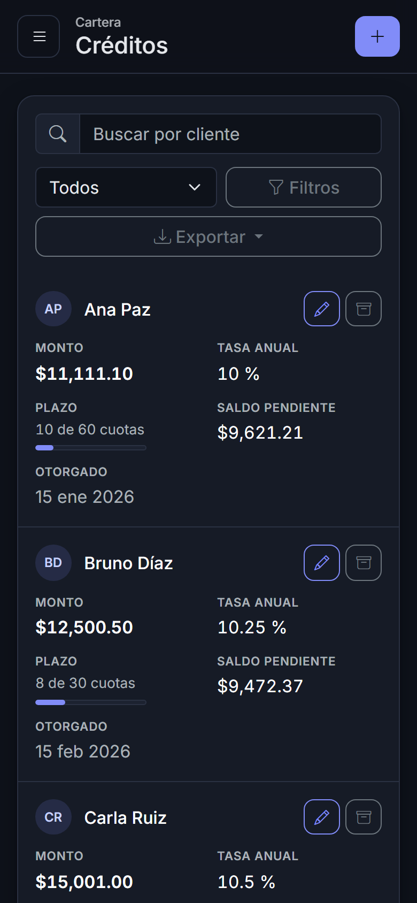

# Sistema de Gestión de Créditos

## 📌 Descripción
Este proyecto es una aplicación web desarrollada en **Python (Flask) y SQLite** para la gestión de créditos otorgados a clientes. Permite registrar créditos, cobrar sus pagos, dar seguimiento a los atrasos y descargar reportes, además de visualizar la cartera en gráficos interactivos con **Chart.js**.<br>



## 🛠 Tecnologías Utilizadas
### Backend
- **Python** con **Flask** (Framework ligero para aplicaciones web).
- **SQLite** (Base de datos liviana y embebida).
- **SQLAlchemy** (ORM) y **Flask-Migrate / Alembic** (migraciones de base de datos).
- **marshmallow** y **flask-smorest** (validación, serialización y documentación OpenAPI).
- **openpyxl** y **fpdf2** (reportes en Excel y PDF).
### Frontend
- **HTML, CSS y JavaScript** (Interfaz de usuario).
- **Bootstrap** (Diseño responsivo y atractivo).
- **SweetAlert2** (Alertas interactivas y modernas).
- **Chart.js** (Generación de gráficos estadísticos).
### Pruebas
- **pytest** (backend) y **Playwright** (pruebas en el navegador).<br>

## 🚀 Funcionalidades
✅ Registro de créditos con **simulación en vivo de la cuota mensual** (sistema de cuota fija).<br>
✅ **Registro de pagos**: cada pago cubre las cuotas en orden; el saldo, las cuotas pagadas y el próximo pago salen de los pagos reales.<br>
✅ **Control de atrasos**: créditos vigentes, atrasados (alguna cuota vencida sin pagar) o concluidos (liquidados), con monto vencido y días de atraso.<br>
✅ **Tabla de amortización** de cada crédito, con el estado de cada cuota: pagada, vencida o pendiente.<br>
✅ **Reportes en Excel y PDF**: la cartera filtrada y el **estado de cuenta** de cada crédito.<br>
✅ **Archivar créditos** en lugar de borrarlos: salen de la cartera y del panel, pero conservan sus datos, pagos e historial.<br>
✅ **Aviso de edición simultánea**: si otra persona guardó el crédito mientras lo editabas, no se sobrescriben sus cambios.<br>
✅ **Historial de cambios** de cada crédito: ediciones, pagos, archivado y restauración, con el usuario que hizo cada uno.<br>
✅ Listado con búsqueda, **filtro por estado**, orden por columna, filtros por fechas y montos, **tamaño de página** y exportación a CSV, Excel o PDF.<br>
✅ Panel con filtro de periodo, saldo pendiente, **monto vencido**, tasa ponderada por monto, monto por mes, créditos por plazo, clientes con mayor monto y **cuotas vencidas y por vencer**.<br>
✅ **Inicio de sesión con roles** (Administrador, Analista y Consulta), **administración de usuarios desde la aplicación** y cambio de la contraseña propia.<br>
✅ Bloqueo temporal tras intentos fallidos, protección CSRF, cabeceras de seguridad (CSP con nonce) y librerías del CDN con **hashes de integridad (SRI)**.<br>
✅ **Registro de actividad** (logs) y **respaldos automáticos** de la base de datos.<br>
✅ Menú lateral, tema claro y oscuro, y diseño adaptable a móvil.<br>
<br>

## 🔧 Instalación y Configuración
### 1️⃣ Requisitos Previos
- **Python 3.11** o superior.
- **Git** para clonar el repositorio.
### 2️⃣ Pasos de Instalación
```sh
# Clonar el repositorio
git clone https://github.com/IrvinSegura/Registros-de-Creditos
cd Registros-de-Creditos

# Crear y activar un entorno virtual
python -m venv .venv
source .venv/bin/activate  # En Windows: .venv\Scripts\activate

# Instalar las dependencias (incluye las de desarrollo y pruebas)
pip install -r requirements-dev.txt

# Configurar variables de entorno
cp .env.example .env

# Crear la base de datos aplicando las migraciones
flask db upgrade

# Crear el primer usuario (pide el nombre y la contraseña)
flask users create admin --role admin

# Ejecutar la aplicación en desarrollo (--debug recarga el código al guardar)
flask run --debug

# Acceder a la aplicación en el navegador
http://127.0.0.1:5000/
```

### 3️⃣ Variables de entorno
| Variable | Descripción | Valor por defecto |
|---|---|---|
| `APP_ENV` | `development`, `testing` o `production` | `development` |
| `SECRET_KEY` | Clave secreta de Flask (obligatoria en producción) | solo para desarrollo |
| `DATABASE_URL` | URL de la base de datos (las rutas SQLite relativas se crean en `instance/`) | `sqlite:///credits.db` |
| `APP_TIMEZONE` | Zona horaria del negocio: define qué día es "hoy" para fechas, estados y vencimientos, aunque el servidor esté en otra zona | `America/Mexico_City` |
| `LOG_LEVEL` | Nivel de los logs: `DEBUG`, `INFO`, `WARNING` o `ERROR` | `INFO` |
| `LOG_FILE` | Archivo de logs (rota a los 5 MB y guarda 5 copias); vacío = consola. Las rutas relativas se crean en `instance/` | vacío |
| `BACKUP_DIR` | Carpeta de los respaldos de la base (las rutas relativas se crean en `instance/`) | `backups` |
| `BACKUP_KEEP` | Cuántos respaldos conservar; los más viejos se borran | `30` |
| `BACKUP_INTERVAL_HOURS` | Cada cuántas horas respalda `serve.py` la base (`0` = nunca) | `24` |
| `HOST`, `PORT`, `THREADS` | Dirección, puerto e hilos del servidor de producción (`serve.py`) | `127.0.0.1`, `8000`, `8` |
| `TRUSTED_PROXY` | IP del proxy inverso que atiende HTTPS, para confiar en sus cabeceras `X-Forwarded-*` | vacío (ninguno) |

### 4️⃣ Producción
El servidor de desarrollo de Flask no es para producción. La aplicación incluye `serve.py`, que usa **Waitress** (funciona en Windows y Linux):

```sh
# En .env: APP_ENV=production y una SECRET_KEY larga y aleatoria
flask db upgrade
python serve.py
```

En producción la cookie de sesión solo viaja por HTTPS, así que la aplicación debe quedar detrás de un proxy inverso con certificado (IIS, nginx, Caddy...). Indica la IP de ese proxy en `TRUSTED_PROXY`; si no, no podrás iniciar sesión por HTTP.

Para monitorear el servidor, **`GET /health`** no requiere sesión y responde `{"status": "ok", "database": "ok"}`, o `503` si la base de datos no contesta. Sus llamadas no se escriben en el log de peticiones.

### 5️⃣ Logs
La aplicación escribe en un mismo formato sus propios mensajes, los de Waitress y **una línea por petición** (método, ruta, código de respuesta, duración, usuario e IP). Además registra los créditos creados, editados, archivados y eliminados, los pagos, los cambios de usuarios y los inicios de sesión fallidos. Con `LOG_FILE=app.log` los logs van a `instance/app.log`, que rota solo para no llenar el disco.

### 6️⃣ Respaldos
`python serve.py` copia la base de datos al arrancar y luego cada `BACKUP_INTERVAL_HOURS` horas, en `instance/backups/` (`credits-AAAAMMDD-HHMMSS.db`). La copia se hace con el respaldo en línea de SQLite, así que la aplicación sigue funcionando mientras tanto, y solo se conservan los `BACKUP_KEEP` más recientes.

```sh
flask backup create   # respaldo inmediato
flask backup list     # respaldos guardados
```

Para restaurar uno: detén el servidor, guarda aparte el `credits.db` actual, copia el respaldo elegido en su lugar con el nombre `credits.db` y vuelve a arrancar. Conviene copiar también la carpeta de respaldos a otro disco o a la nube.

## 👥 Usuarios y roles
Toda la aplicación y la API requieren iniciar sesión. Los administradores manejan las cuentas desde la vista **Usuarios** (crear, cambiar nombre, rol o acceso, poner una contraseña nueva y cerrar sesiones), y cualquier usuario puede **cambiar su propia contraseña** con el botón de la llave junto a su nombre.

| Rol | Consultar y descargar reportes | Registrar, editar y cobrar | Archivar, eliminar pagos y administrar usuarios |
|---|:---:|:---:|:---:|
| `admin` (Administrador) | ✅ | ✅ | ✅ |
| `analyst` (Analista) | ✅ | ✅ | ❌ |
| `viewer` (Consulta) | ✅ | ❌ | ❌ |

Desde la terminal también se pueden administrar (útil para crear el primer usuario o recuperar el acceso):

```sh
flask users create <usuario> --role analyst   # admin | analyst | viewer
flask users list
flask users set-password <usuario>            # también desbloquea la cuenta y cierra sus sesiones
flask users end-sessions <usuario>            # cierra sus sesiones sin cambiar la contraseña
flask users sign-ins                          # últimos intentos de inicio de sesión (se guardan 90 días)
flask users deactivate <usuario>              # cierra sus sesiones abiertas
flask users activate <usuario>
```

- Las contraseñas se guardan con hash (scrypt) y deben tener al menos 10 caracteres.
- Tras 5 intentos fallidos la cuenta se bloquea 15 minutos, y tras 10 intentos fallidos desde una misma conexión (con cualquier usuario) esa conexión se bloquea 15 minutos.
- Cada intento de inicio de sesión queda registrado con su dirección IP.
- La sesión dura 8 horas; la cookie es `HttpOnly`, `SameSite=Lax` y, en producción, `Secure`.
- Cambiar la contraseña, cerrar las sesiones o desactivar la cuenta saca al usuario de todos los navegadores donde tenga sesión abierta. Al cambiar tu propia contraseña, la sesión desde la que la cambiaste sigue abierta.
- Un administrador no puede quitarse su propio rol ni desactivar su propia cuenta.
- Las páginas y respuestas de la API no se guardan en la caché del navegador (`Cache-Control: no-store`).

## 💵 Pagos, atrasos y archivo
- Cada pago tiene fecha, monto y una nota opcional (por ejemplo, el número de transferencia). No puede ser anterior al otorgamiento, posterior a hoy ni mayor a lo que falta por pagar.
- Los pagos cubren las cuotas **en orden**; un pago parcial se aplica primero al interés y luego al capital.
- Un crédito está **atrasado** cuando tiene una cuota vencida (de ayer o antes) sin pagar por completo, y **concluido** cuando está liquidado.
- Un pago registrado por error lo puede eliminar un administrador; el historial conserva el registro.
- Al editar un crédito con pagos, los nuevos datos deben seguir cubriendo lo ya pagado.
- **Archivar** saca el crédito de la cartera, del panel y de los reportes, y lo deja de solo lectura; se ve con el filtro *Archivados* y se puede restaurar. Solo un crédito archivado se puede **eliminar definitivamente**.
- Al aplicar la migración que agregó los pagos, a cada crédito existente se le registró un pago por las cuotas vencidas hasta ese día (se asumen puntuales), así que sus saldos no cambiaron.



## 🗂 Estructura del proyecto
```
app/
├── __init__.py        # Application factory (create_app)
├── config.py          # Configuración por entorno
├── extensions.py      # SQLAlchemy, Migrate y Api (OpenAPI)
├── errors.py          # Errores de dominio y su respuesta JSON
├── logs.py            # Formato de los logs y una línea por petición
├── security.py        # Cabeceras de seguridad, Content Security Policy y tokens CSRF
├── auth/              # Inicio de sesión, protección de rutas y permisos por rol
├── cli.py             # Comandos `flask users ...` y `flask backup ...`
├── models/            # Modelos SQLAlchemy: crédito, pago, historial de cambios, usuario
├── schemas/           # Validación y serialización (marshmallow)
├── services/          # Lógica de negocio, amortización, reportes y respaldos, sin dependencias de HTTP
├── api/v1/            # Endpoints REST versionados: créditos, pagos y usuarios
├── web/               # Páginas renderizadas en el servidor
├── templates/
│   ├── base.html      # Esqueleto HTML: tema y librerías
│   ├── app.html       # Layout de la aplicación: menú lateral, barra superior y usuario
│   ├── index.html     # Vistas de la aplicación
│   ├── auth/          # Página de inicio de sesión
│   ├── errors/        # Páginas de error
│   ├── macros/        # Campos de formulario compartidos
│   ├── views/         # Una plantilla por vista: dashboard, credits, register, users
│   └── components/    # Paneles y ventanas: credit-detail, edit-modal, user-modal, password-modal
└── static/            # css/ y js/ siguen la misma organización que templates/
    ├── img/           # Favicon
    ├── css/
    │   ├── base.css   # Variables de diseño (tema claro y oscuro), menú, tarjetas, formularios y botones
    │   ├── views/     # Estilos de cada vista
    │   └── components/
    └── js/
        ├── main.js    # Punto de entrada que conecta las vistas y los componentes
        ├── lib/       # API, enrutador, formularios, formato (es-MX), avisos, estados, tema y acciones de crédito
        ├── views/     # dashboard, credits, register, users
        └── components/ # credit-detail, edit-modal, user-modal, password-modal, credit-rows, quote-panel, portfolio-charts
docs/screenshots/      # Capturas de este README
migrations/            # Migraciones de base de datos (Alembic)
tests/                 # Pruebas con pytest; tests/e2e/ son las pruebas en el navegador
serve.py               # Servidor de producción (Waitress) y respaldos programados
wsgi.py                # Punto de entrada
```

## 📡 API REST
La documentación interactiva (Swagger UI) está en **`/api/docs`** y la especificación OpenAPI en `/api/openapi.json`.

| Método | Ruta | Descripción |
|---|---|---|
| `GET` | `/api/v1/credits` | Lista paginada (`page`, `per_page` hasta 100). Filtros: `client_name`, `status` (`active`, `overdue`, `completed` o `archived`), `issue_date_from`, `issue_date_to`, `amount_min`, `amount_max`. Orden: `sort` y `order` (`asc`/`desc`). Los archivados solo aparecen con `status=archived` |
| `POST` | `/api/v1/credits` | Registra un crédito |
| `GET` | `/api/v1/credits/export?format=xlsx` | Descarga los créditos con los mismos filtros y orden, en `csv`, `xlsx` o `pdf` |
| `GET` | `/api/v1/credits/quote?amount=10000&interest_rate=12&term_months=12` | Simula la cuota mensual, los intereses y el total a pagar |
| `GET` | `/api/v1/credits/summary` | Totales de la cartera (sin archivados): créditos por estado, saldo pendiente, monto vencido, pagado, tasa ponderada, monto por mes, créditos por plazo, clientes con mayor monto y cuotas vencidas o por vencer; acepta `issue_date_from` e `issue_date_to` |
| `GET` | `/api/v1/credits/{id}` | Obtiene un crédito con su estado (`standing`): cuotas pagadas, pagado, saldo, próximo pago, monto vencido y días de atraso. La cabecera `ETag` lleva su versión |
| `PUT` | `/api/v1/credits/{id}` | Actualiza un crédito. Con `If-Match: "<versión>"`, responde `412` si alguien lo guardó después |
| `DELETE` | `/api/v1/credits/{id}` | Elimina definitivamente un crédito archivado, con sus pagos e historial |
| `POST` | `/api/v1/credits/{id}/archive` y `/restore` | Archiva o restaura un crédito |
| `GET` | `/api/v1/credits/{id}/amortization` | Tabla de amortización con el estado de cada cuota |
| `GET` | `/api/v1/credits/{id}/statement?format=pdf` | Estado de cuenta en `pdf` o `xlsx` |
| `GET` | `/api/v1/credits/{id}/history` | Historial de cambios, del más reciente al más antiguo |
| `GET`, `POST` | `/api/v1/credits/{id}/payments` | Pagos del crédito / registra un pago (`amount`, `paid_on`, `note`) |
| `DELETE` | `/api/v1/credits/{id}/payments/{payment_id}` | Elimina un pago registrado por error |
| `GET`, `POST` | `/api/v1/users` | Lista o crea usuarios (administradores) |
| `PUT` | `/api/v1/users/{id}` | Cambia nombre, rol o acceso de un usuario |
| `POST` | `/api/v1/users/{id}/password` y `/end-sessions` | Pone una contraseña nueva o cierra sus sesiones |
| `POST` | `/api/v1/account/password` | Cambia la contraseña propia (`current_password`, `new_password`) |

Todas las rutas requieren una sesión iniciada (sin ella responden `401`); la API es para el frontend de la propia aplicación y no acepta llamadas desde otros dominios. Desde `/api/docs`, "Try it out" ya envía el token CSRF de tu sesión. Las peticiones que modifican datos (`POST`, `PUT`, `DELETE`) deben enviar además la cabecera `X-CSRF-Token` con el token de la página, y el rol del usuario debe permitir la acción (si no, `403`).

La tasa de interés es **anual** y se paga mensualmente. La cuota se calcula con el sistema de cuota fija (francés) y la última cuota absorbe el redondeo para que el saldo termine exactamente en cero.

Los montos y tasas se manejan como decimales exactos y se devuelven como texto (`"15000.50"`). Los errores siguen siempre el mismo formato:
```json
{"code": 422, "status": "Unprocessable Entity", "errors": {"json": {"term_months": ["El plazo debe estar entre 1 y 360 meses."]}}}
```

## 🧪 Pruebas
```sh
# Pruebas del backend
pytest

# Con el reporte de cobertura: líneas de app/ que ninguna prueba ejecuta (falla por debajo del 90 %)
pytest --cov

# Vulnerabilidades conocidas en las dependencias fijadas
pip-audit -r requirements-dev.txt

# Pruebas en el navegador (la primera vez, instala Chromium); necesitan internet por las librerías del CDN
python -m playwright install chromium
pytest -m e2e
```

La integración continua (GitHub Actions) corre flake8, las pruebas con cobertura, `pip-audit` y las pruebas en el navegador en cada push y pull request, en cualquier rama. Además, **Dependabot** abre cada semana un pull request para actualizar las dependencias de Python y de GitHub Actions.

## 🗃 Migraciones
```sh
# Después de modificar un modelo
flask db migrate -m "descripción del cambio"
flask db upgrade
```

La aplicación activa las llaves foráneas de SQLite en cada conexión, así que la base rechaza datos huérfanos. Durante las migraciones se desactivan, porque Alembic reconstruye las tablas de SQLite y, con las llaves activas, borraría en cascada el historial de los créditos.

## 🖼 Capturas
| Créditos | Pagos de un crédito |
|---|---|
|  |  |

| Usuarios | Móvil (tema oscuro) |
|---|---|
|  |  |
